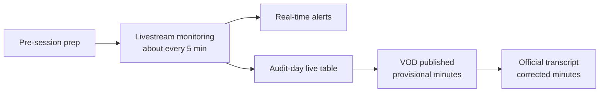

🌐 [한국어](README.md) | [English](README.en.md)


# Seoul Council Session Monitor

[](LICENSE)
[](README.md)
[](README.en.md)
[](SKILL.md)

Hand the Seoul Metropolitan Council's session livestreams to an AI. It watches the stream through the whole session, alerts a designated channel the moment a relevant question comes up, and writes the minutes in two stages: provisional, then corrected.

Its core use case is monitoring during the administrative audit and writing the minutes.

Works with any AI agent that reads skills — Claude Code, Codex, Muse, and others.

## What it covers

| Feature | Description |
| --- | --- |
| 📋 Pre-session prep | Briefing material, committee roster, and schedule checks |
| 📺 Live monitoring | Checks about every 5 minutes — alerts for start, recess, resume, end, and relevant hits |
| 💬 Subtitle-state handling | A six-case decision tree for when captions are live, missing, stalled, or recovering |
| 📝 Minutes (two stages) | Provisional minutes from the VOD (ASR), corrected after cross-checking the official transcript |
| 🏛️ Audit-day live table | On the audited body's own audit day, a live table of each member's questions, answers, and document requests |
| 💬 Message templates | Ready-to-use templates: opening notice, day plan, audit-day notice, live-update alert, closing, and feedback request |
| 🛠️ Tooling references | Recording (yt-dlp, streamlink), transcription (WhisperX, WhisperLiveKit), interval caption checks (jiffshot) |

## How it works



## Install

```bash
# Copy into your AI's skills directory (Claude Code example below)
mkdir -p ~/.claude/skills/audit-monitor
cp SKILL.ko.md ~/.claude/skills/audit-monitor/SKILL.md  # Korean version
# cp SKILL.md ~/.claude/skills/audit-monitor/SKILL.md  # English version
```

Then adapt the placeholders:

- `[target institution]`, `[Operator role]`, `[Operator name]`
- `[Feedback survey URL]`
- The reference URLs under "Pre-session prep" (the example is Seoul Metropolitan Council)

No real names, internal channels, or fixed dates are included. The reference URLs are Seoul Metropolitan Council's — swap in your own council's addresses to reuse it elsewhere.

## One second

⭐ If you like it, give it a star. You'll reach for it again at the next session.

## Origin

Distilled from an operating manual used for a 2026 Seoul Metropolitan Council administrative audit monitoring run (Nov 6–13), plus reference implementations found on GitHub for transcription and real-time monitoring. The manual's procedures were generalized; its internal details were removed.

## License

MIT. See [LICENSE](LICENSE).
