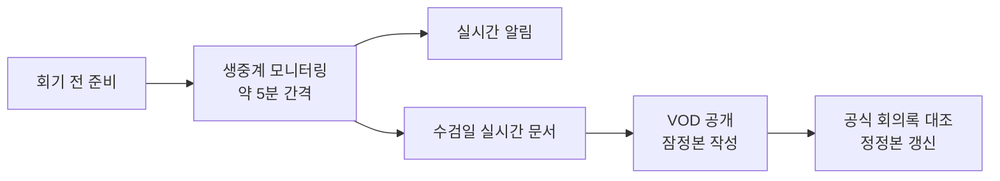

🌐 [한국어](README.md) | [English](README.en.md)


# 서울시의회 생중계 모니터링

[](LICENSE)
[](README.md)
[](README.en.md)
[](SKILL.md)

서울시의회 회기중 생중계, AI에게 맡기세요. 회기 내내 생중계를 지켜보고, 관련 질의가 나오면 지정한 채널로 바로 알리고, 회의록은 잠정본에서 정정본까지 두 단계로 정리합니다.

핵심 용도는 행정사무감사 기간의 실시간 모니터링과 회의록 작성입니다.

Claude Code, Codex, Muse 등 스킬을 읽는 AI 에이전트에서 쓸 수 있습니다.

## 이 스킬이 하는 일

| 기능 | 설명 |
| --- | --- |
| 📋 회기 전 준비 | 브리핑 자료, 당일 위원회 명단·일정 확인 |
| 📺 실시간 모니터링 | 약 5분 간격 확인 — 개시·정회·재개·종료와 관련 포착 사항 알림 |
| 💬 자막 상태 대응 | 자막 있음·없음·멈춤·복구 등 6가지 경우별 판단 기준 |
| 📝 회의록 (2단계) | 영상회의록(VOD) 기반 잠정본 → 공식 문자 회의록 대조 후 정정본 |
| 🏛️ 수검일 실시간 문서 | 수감기관 본인 수검일에는 위원별 질의·답변·요구자료 표를 실시간 갱신 |
| 💬 메시지 틀 | 개설 안내·당일 감시계획·수검일 안내·실시간 갱신 알림·마감·종료 안내까지 그대로 쓰는 틀 |
| 🛠️ 도구 참고자료 | 녹화(yt-dlp·streamlink), 전사(WhisperX·WhisperLiveKit), 간격 자막 확인(jiffshot) |

## 어떻게 돌아가나



## 설치

```bash
# 사용하는 AI의 스킬 디렉터리에 복사한다 (아래는 Claude Code 예시)
mkdir -p ~/.claude/skills/audit-monitor
cp SKILL.ko.md ~/.claude/skills/audit-monitor/SKILL.md  # 한글판
# cp SKILL.md ~/.claude/skills/audit-monitor/SKILL.md  # 영문판
```

설치한 뒤 자리표시자만 바꾸면 됩니다.

- `[대상 기관]`, `[운영자 직위]`, `[운영자 성명]`
- `[종료 설문 URL]`
- "회기 전 준비"에 있는 참조 URL (예시는 서울특별시의회)

실명, 내부 채널, 고정된 날짜는 들어 있지 않습니다. 참조 URL은 서울특별시의회 기준이라, 다른 의회에 쓸 때는 해당 의회 주소로 바꾸면 됩니다.

## 잠깐만

⭐ 마음에 들면 스타 하나 눌러주세요. 다음 회기 때 또 쓰게 될 겁니다.

## 출처

2026년 서울시의회 행정사무감사 모니터링 운영(11월 6~13일)에 쓴 업무 매뉴얼의 절차를 일반화한 것입니다. 내부 세부사항은 뺐습니다. 전사와 실시간 모니터링 참고자료는 깃허브에서 찾았습니다.

## 라이선스

MIT. [LICENSE](LICENSE) 파일 참고.
